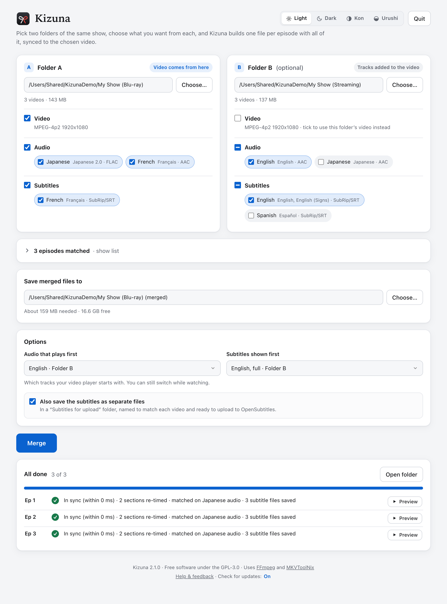
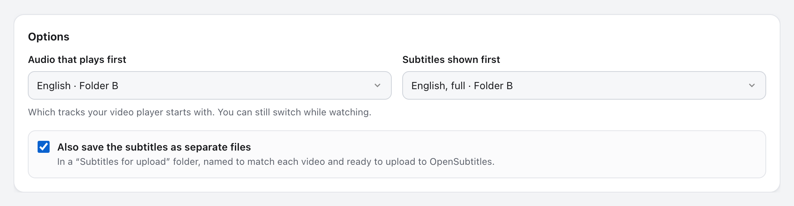
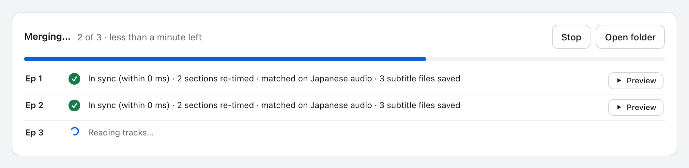
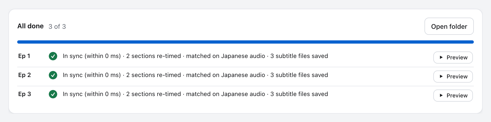
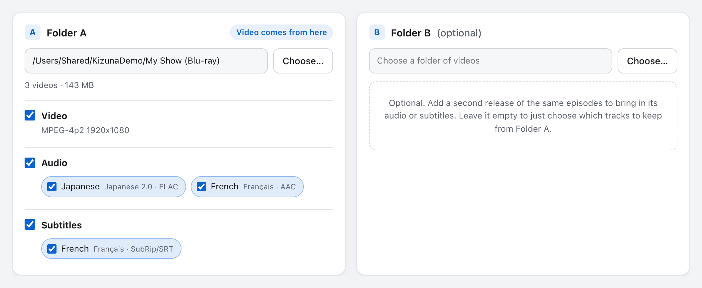
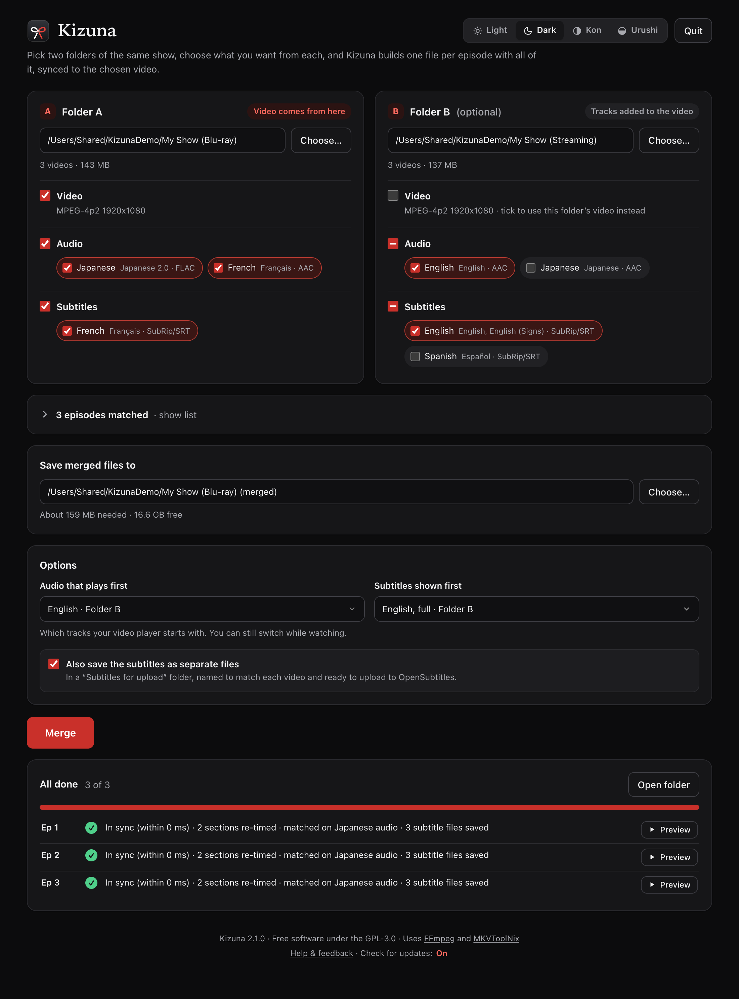
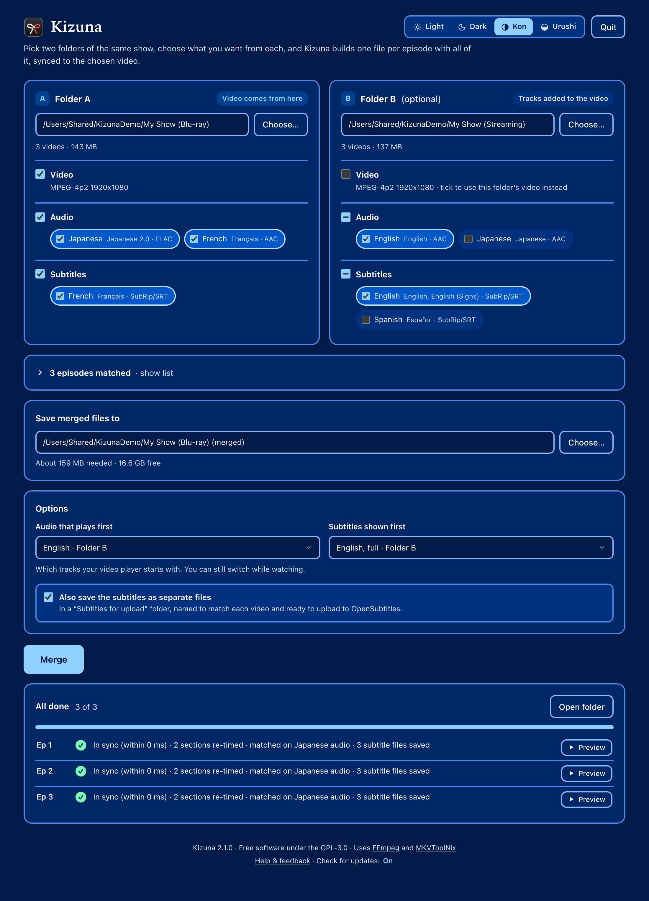
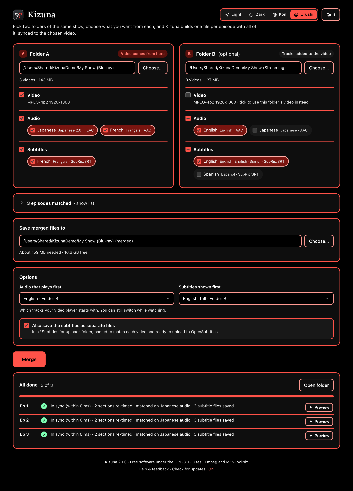

# Changelog

## [2.1.0]


**The first public release of Kizuna (絆, Japanese for "bond"): combine the best parts of two releases of the
same show, in sync, automatically.**

Have one copy with great video (say, a Blu-ray) and another with the audio or subtitles you
want (say, an English dub from a streaming service)? Pick both folders, tick what you want
from each, and Kizuna builds one MKV file per episode with everything in it, lined
up to the picture. Free and open source.



### Which file do I download?

| Your computer | Download this |
|---|---|
| **Windows 10 or 11** (64-bit) | `Kizuna-2.1.0-Windows-x64-Setup.exe` |
| **Mac with Apple Silicon** (M1, M2, M3, M4 …) | `Kizuna-2.1.0-macOS-arm64.dmg` |
| **Mac with an Intel processor** | `Kizuna-2.1.0-macOS-x86_64.dmg` |

Not sure which Mac you have? Apple menu → **About This Mac**. "Chip: Apple M…" means
Apple Silicon; "Processor: Intel" means Intel. macOS 13 (Ventura) or newer is needed.
Everything is included: no need to install ffmpeg or MKVToolNix separately.

### Installing (one-time)

These downloads aren't signed with paid certificates yet, so the first time your computer
asks you to confirm:

- **Windows:** run the Setup file. If you see *"Windows protected your PC"*, click
  **More info → Run anyway**. No administrator rights needed. Kizuna then appears in
  the Start menu.
- **Mac:** open the `.dmg` and drag **Kizuna** into **Applications**, then open it. If
  macOS says it can't verify the app, go to **System Settings → Privacy & Security**, scroll
  down, click **Open Anyway** and confirm.

### Quick start

1. Open **Kizuna**. It opens as a page in your web browser and runs only on your
   computer.
2. **Folder A:** choose the folder whose video you want to keep. **Folder B:** choose the
   folder with the extra audio or subtitles.
3. Tick the languages you want from each folder.
4. Choose where to save, set the options you want, and press **Merge**.

Your original files are never changed. Next time, your last setup is already filled in.

### Features

**Automatic sync, even when the releases are cut differently.** Kizuna compares the
audio both versions share to find exactly how they line up, including streaming intros and
credits and small gaps at scene breaks, and corrects each section. Every episode is
checked afterwards and marked ✓ (in sync) or **!** (please spot-check).

**Choose what plays first.** Pick the audio and subtitles your video player starts with,
for example the English dub with English subtitles, or signs-only subtitles.



**See it working.** Live progress with an estimate of the time left, two episodes at once on
faster computers, and a notification when everything is done.



**Check any episode in seconds.** **Preview** opens a 20-second clip in your video player
around a point where the timing was adjusted, with the added tracks switched on.



**Clean-up mode.** Leave Folder B empty to just choose which tracks to keep, for example to
drop subtitle languages you'll never use.



**Save subtitles for sharing.** Optionally save every text subtitle track as its own file,
synced to the merged video and named the way players and OpenSubtitles expect, plus an
`Upload info.txt` with each video's OpenSubtitles movie hash:

```text
Subtitles for upload/
  My Show - S01E01 - 1080p BluRay.en.srt           English
  My Show - S01E01 - 1080p BluRay.en.forced.srt    English, signs / forced only
  My Show - S01E01 - 1080p BluRay.fr.srt           French
  Upload info.txt
```

**Four themes:** Light; Dark, in the logo's black and red; and two high-contrast themes,
**Kon** (紺, navy blue) and **Urushi** (漆, black-and-red lacquer). Every theme meets the
WCAG AA contrast standard.

| Dark | Kon (high contrast) | Urushi (high contrast) |
|---|---|---|
|  |  |  |

**Also:** remembers your last setup · tells you when a new version is out · keeps video
quality (never re-encoded) · keeps lossless audio lossless · keeps fonts for styled
subtitles · asks before replacing files.

### Good to know

- The two versions need **one audio track in common** (for example both have the original
  Japanese audio). If they don't match, Kizuna says so instead of guessing.
- **Picture-based subtitles** (Blu-ray PGS) can't be re-timed when the versions are cut
  differently; they're skipped and the episode says so.
- **Privacy:** your videos and file names never leave your computer. Once per launch,
  Kizuna asks GitHub for the latest version number (nothing about you is sent); you
  can turn this off at the bottom of the page.

### Help and feedback

Read the [guide](https://github.com/1965fordF250/kizuna#readme), or
[open an issue](https://github.com/1965fordF250/kizuna/issues/new?template=bug_report.md)
for bugs and ideas. Please attach the log files it mentions.
