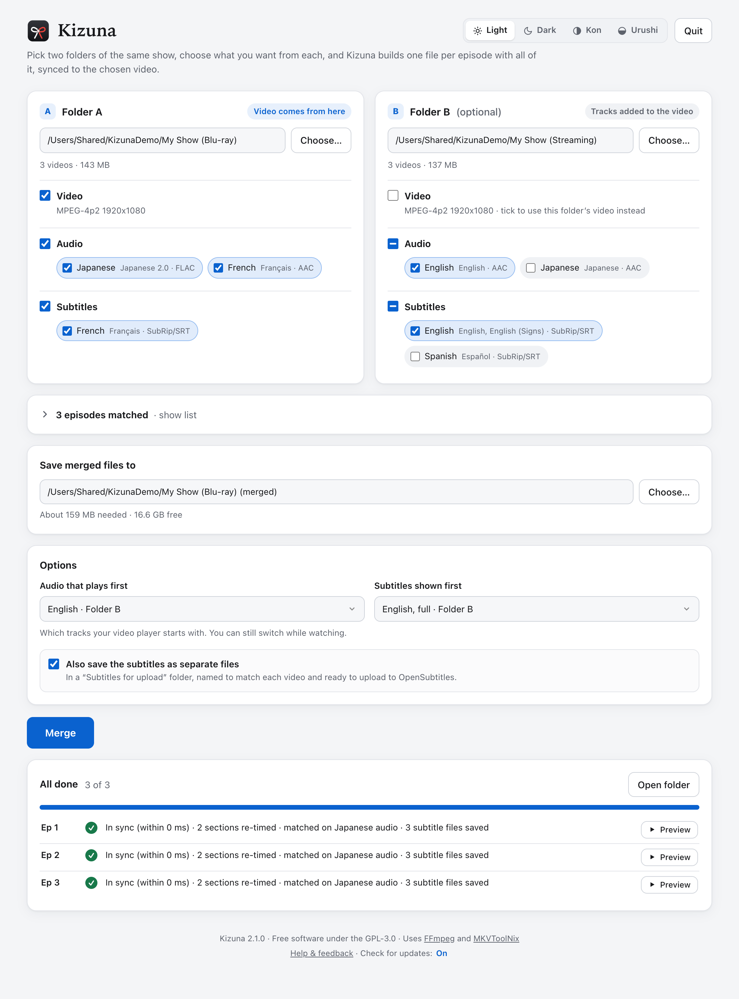
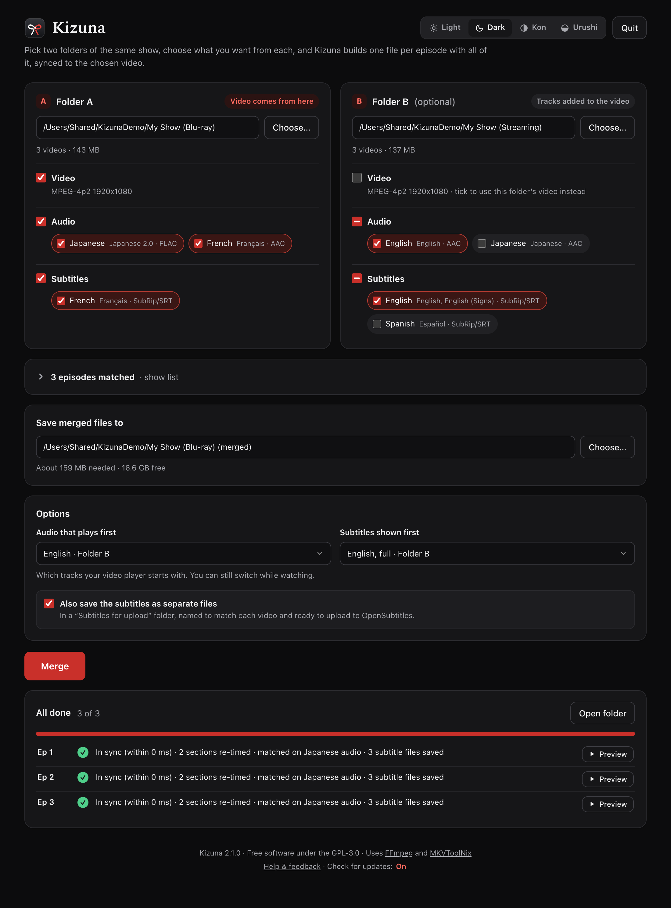
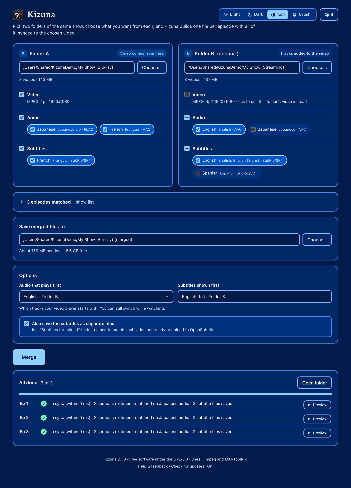
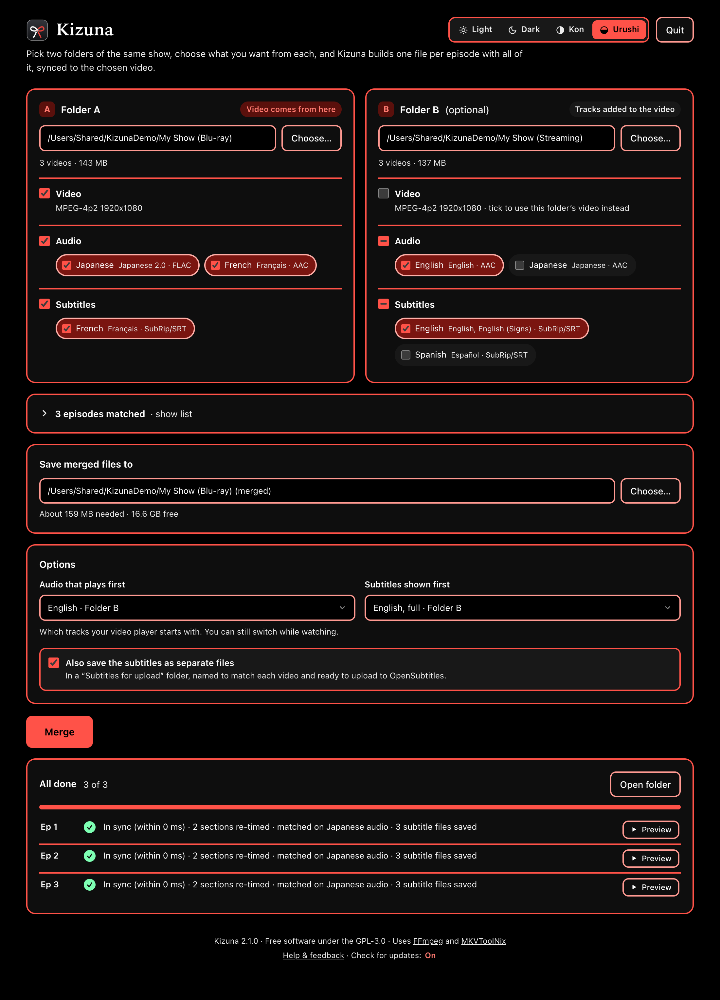
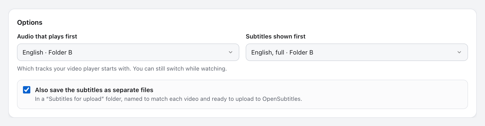
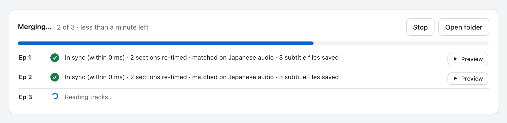
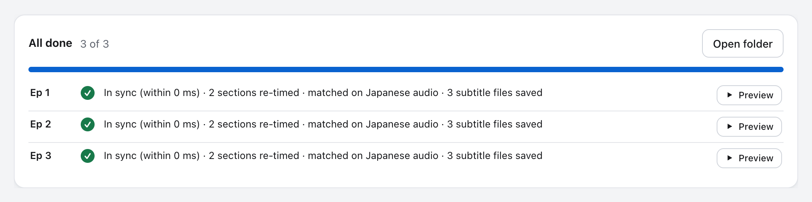
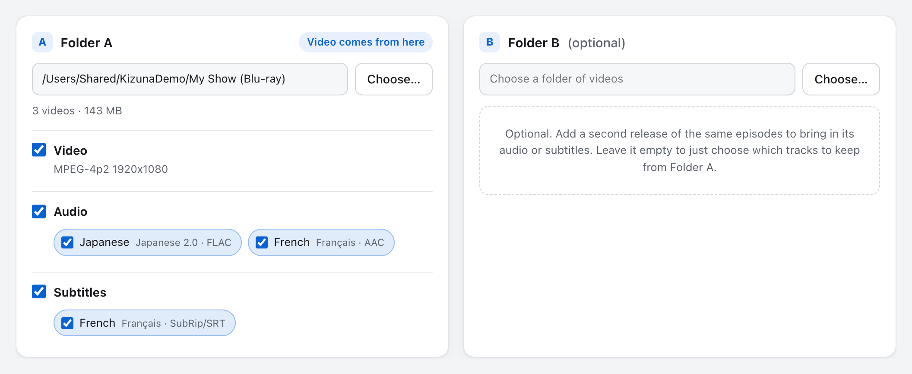

# Kizuna

*Kizuna* (絆) is Japanese for "bond". The character is built on 糸, "thread": two releases, tied
into one.

**Combine the best parts of two releases of the same show, in sync, automatically.**

Have one copy with great video (say, a Blu-ray) and another with the audio or subtitles you
want (say, an English dub from a streaming service)? Pick both folders, tick what you want
from each, and Kizuna builds one MKV file per episode with everything in it, lined
up to the picture. Free, open source, for Windows and Mac.

https://github.com/user-attachments/assets/acac6945-80dc-4507-914a-b493ffed3152

**[▶ Watch in 4K on YouTube](https://youtu.be/uRlEM6GNfow)**

- **Simple:** two folders, tick Video, Audio and Subtitles by language, press Merge.
- **Syncs automatically, even when the releases are cut differently.** Streaming intros and
  credits, or small gaps at scene breaks, are found and corrected section by section.
- **Checks every episode** after merging and tells you if any needs a look, with a
  one-click **Preview** to see for yourself.
- **Plays the way you want:** choose which audio and subtitles your player starts with.
- **Clean-up mode:** use just one folder to strip tracks you don't want, like 30
  subtitle languages you'll never use.
- **Saves subtitles for sharing**, named and ready to upload to OpenSubtitles.
- **Remembers your setup**, estimates the time left, notifies you when it's done, and works on
  two episodes at once on faster computers.
- **Keeps quality:** video is never re-encoded, and your original files are never touched.
- **Everything included:** the Windows and Mac downloads contain ffmpeg and MKVToolNix.
- **Four themes:** Light; Dark, in the logo's black and red; and two high-contrast themes,
  **Kon** (紺, navy blue) and **Urushi** (漆, black-and-red lacquer).

| Light | Dark |
|---|---|
|  |  |
| **Kon** (high contrast) | **Urushi** (high contrast) |
|  |  |

## Download

Get the latest version from the [**Releases page**](https://github.com/1965fordF250/kizuna/releases/latest):

| Your computer | Download |
|---|---|
| Windows 10 or 11 (64-bit) | `Kizuna-<version>-Windows-x64-Setup.exe` |
| Mac with Apple Silicon (M1 or newer) | `Kizuna-<version>-macOS-arm64.dmg` |
| Mac with an Intel processor | `Kizuna-<version>-macOS-x86_64.dmg` |

Not sure which Mac you have? Apple menu → **About This Mac**: "Chip: Apple M…" means
Apple Silicon; "Processor: Intel" means Intel. macOS 13 (Ventura) or newer is required.

### First launch (one-time)

The downloads aren't code-signed yet (see the [code signing policy](#code-signing-policy)),
so your computer will ask you to confirm the first time.

**Windows:** if SmartScreen says *"Windows protected your PC"*, click **More info**, then
**Run anyway**. The installer doesn't need administrator rights.

**macOS:** open the disk image and drag **Kizuna** onto **Applications**, then open it.
If macOS says it can't verify the app:
1. Open **System Settings → Privacy & Security**.
2. Scroll down and click **Open Anyway** next to the Kizuna message, then confirm.

## How to use it

1. Open **Kizuna**. It opens as a page in your web browser. It runs only on your
   computer; your videos are never uploaded anywhere.
2. Click **Choose…** for **Folder A** and **Folder B**: two folders with the same episodes
   from different releases.
3. Tick **Video** in the folder whose picture you want to keep. The other folder's tracks
   are synced to it.
4. Under **Audio** and **Subtitles**, tick the languages you want from each folder.
5. Check the episode list. Episodes are matched by number (`S01E05`, `- 05`, `Episode 5`,
   `1x05`, …), and you can untick any you want to skip.
6. Choose where to save the merged files, set any **Options** (below), and press **Merge**.

Next time you open Kizuna, your last folders and choices are already filled in.

### Options



- **Audio that plays first / Subtitles shown first:** which tracks your video player
  starts with. For example, pick the English dub and English subtitles so episodes open in
  English on Plex, Jellyfin, VLC and so on. "Keep as in the files" leaves it as it was.
  Subtitles can be *full* or *signs / forced only* (just on-screen text and songs).
  Any "forced" flag on the other tracks is removed too, because players like VLC would
  otherwise start with a forced track instead of your choice.
- **Also save the subtitles as separate files:** see [Saving subtitles](#saving-subtitles-as-separate-files-eg-for-opensubtitles).

### While it works



You'll see each episode's progress and roughly how long is left. You get a notification
when everything is done (allow notifications when your browser asks), and the browser tab
title shows ✓. On computers with 6 or more processor cores, two episodes are processed at
once.



Each episode shows ✓ when it's done and in sync, or **!** if it should be spot-checked.
**Preview** opens a 20-second clip in your video player around a point where the timing was
adjusted, with the added audio and subtitles switched on, so you can check the sync in
seconds. A `Kizuna log.txt` is saved next to the merged files.

### Clean-up mode: one folder only



Leave **Folder B** empty to just choose which tracks to keep from Folder A, for example to
drop audio languages or subtitle tracks you don't need. Nothing is re-encoded.

### Saving subtitles as separate files (e.g. for OpenSubtitles)

With **Also save the subtitles as separate files** ticked, every text subtitle track of each
merged video (SRT, ASS/SSA, WebVTT) is also saved in a `Subtitles for upload` folder inside the
output folder. They're exported from the finished file, so they're synced to that exact video.
(The folder isn't called just `Subtitles` on purpose: VLC, Plex and Jellyfin automatically load
subtitle files from a folder with that name and would show them instead of the tracks you chose.)

Files are named the way players and OpenSubtitles expect:

```text
Show - S01E01.en.srt          English
Show - S01E01.en.forced.srt   English, forced / signs only
Show - S01E01.en.sdh.srt      English for the deaf and hard of hearing
Show - S01E01.en.dub.srt      English, another variant (taken from the track's name)
```

`Upload info.txt` in the same folder lists each video's **OpenSubtitles movie hash**, file
size and frame rate, which is what OpenSubtitles uses to match a subtitle to an exact video
release when you upload it. Picture-based subtitles (PGS, VobSub) can't be saved as text
files, so they're skipped, and the episode's result says so.

### Closing it

Click **Quit** at the top of the page. Kizuna also closes by itself after 15 idle
minutes, never while a merge is running. Opening it again brings you back to the page.

## How the syncing works

Both releases usually share at least one audio track, such as the original-language
audio. Kizuna compares that shared audio across the whole episode to find exactly how
the two versions line up, including every point where one version has extra or missing
material. It then:

- **Same cut, just shifted:** shifts the chosen tracks by the measured offset. Nothing is
  re-encoded.
- **Cut differently:** rebuilds the chosen audio section by section on the video's timeline
  (re-encoded at high quality; lossless stays lossless), and re-times text subtitles.

Afterwards it pushes the shared audio through the same steps and measures how closely it
matches, which is the "In sync (within N ms)" you see for each episode.

## Good to know

- **The two versions need a common audio track** (for example both have the Japanese
  audio). Without one, Kizuna can't line them up and will say so instead of guessing.
- **Picture-based subtitles** (Blu-ray PGS, DVD VobSub) are fine when the two versions have
  the same cut, but can't be re-timed in sections. When that's needed they're skipped,
  and the episode's result says so.
- Output files are always **MKV**. Input can be MKV, MP4, M4V or WebM.
- If the output folder already has files with the same names, you're asked before
  anything is replaced.

## Privacy

Kizuna runs entirely on your computer. Your videos, file names and folders never
leave it. The only time it goes online is a **once-per-launch update check**: it asks
GitHub for the latest Kizuna version number so it can tell you when there's a new
one. Nothing about you or your files is sent. Turn it off at the bottom of the page
("Check for updates: On/Off").

## Code signing policy

Free code signing provided by [SignPath.io](https://about.signpath.io/), certificate by
[SignPath Foundation](https://signpath.org/). *(Applied for. Until it's approved, the
Windows downloads are unsigned.)*

- **Committers and reviewers:** [1965fordF250](https://github.com/1965fordF250)
- **Approvers:** [1965fordF250](https://github.com/1965fordF250)

Only installers built by this repository's [Release workflow](.github/workflows/release.yml)
on GitHub Actions, from the source code in this repository, are signed, and every release
is approved by hand before it's signed. Changes from anyone who isn't a committer are
reviewed before they're merged.

**Privacy:** this program will not transfer any information to other networked systems
unless specifically requested by the user or the person installing or operating it. The
one exception is the update check described under [Privacy](#privacy): once per launch it
asks GitHub for the latest version number, sends nothing about you or your files, and can
be turned off.

## Troubleshooting

**The added track plays but some lines are a bit off.** Check the episode's result and
use **Preview**. If it's marked **!**, the two versions may differ in a way that couldn't be
measured (for example a scene that only exists in one of them). Please open an issue with
the log files.

**No notification when it finished.** Your browser asks the first time you press Merge;
if you said no, allow notifications for the Kizuna page in your browser's settings.

**"Missing: ffmpeg, mkvmerge"** appears when running from source without those tools. The
downloads on the Releases page already include them.

**Where are the logs?** `Kizuna log.txt` in your output folder, plus the app log:
- Windows: `%LOCALAPPDATA%\Kizuna\log.txt`
- macOS: `~/Library/Application Support/Kizuna/log.txt`

Found a bug or have an idea? [Open an issue](https://github.com/1965fordF250/kizuna/issues/new?template=bug_report.md)
and attach both logs.

## Running from source

Works on Windows, macOS and Linux with Python 3.9+, [ffmpeg](https://ffmpeg.org) and
[MKVToolNix](https://mkvtoolnix.download) installed (on PATH, or in their usual install
locations).

```bash
git clone https://github.com/1965fordF250/kizuna.git
```

```bash
cd kizuna && python3 -m pip install -r requirements.txt
```

```bash
cd src && python3 -m kizuna
```

Other options: `--no-browser` (print the address instead of opening it),
`--self-test` (run the built-in end-to-end test), `--version`.

## Development

```bash
python3 -m pip install -r requirements.txt pytest
```

```bash
python3 -m pytest
```

The tests generate small synthetic videos whose correct answer is known (a streaming-style
intro, a cut gap, a constant shift) and check that audio lands within 25 ms and subtitles
within 15 ms of where they belong. CI runs them on Windows, macOS and Linux.

Project layout:

| Path | What it is |
|---|---|
| `src/kizuna/engine.py` | Sync detection, re-timing, merging, subtitle export, previews |
| `src/kizuna/server.py` | Local web server for the interface (127.0.0.1 only, per-launch token) |
| `src/kizuna/web/index.html` | The interface |
| `src/kizuna/system.py` | Windows / macOS / Linux differences (tool lookup, folder picker, …) |
| `src/kizuna/selftest.py` | End-to-end self-test used by the tests and the installers |
| `packaging/` | Installer build: pinned tool downloads, PyInstaller spec, Inno Setup script, DMG script |
| `docs/make_screenshots.py` | Regenerates every screenshot in this README at 2× resolution |

### Making a release

1. Update `__version__` in `src/kizuna/__init__.py` and add a section to `CHANGELOG.md`
   (it becomes the release notes).
2. If the interface changed, run `python docs/make_screenshots.py` (needs Playwright and
   Chrome) and commit the new images.
3. Commit, then tag and push: `git tag v1.2.3 && git push origin v1.2.3`.
4. The **Release** workflow tests everything, builds the Windows installer and both macOS
   disk images, self-tests each one (and does a silent install/uninstall on Windows),
   attaches the ffmpeg and MKVToolNix source code, and creates a **draft** release.
5. Review the draft on GitHub and click **Publish**.

To build and test the installers without releasing, run the Release workflow manually
from the Actions tab.

Bundled tool versions are pinned in `packaging/tools.json` with SHA-256 checksums from
their publishers; a mismatching download stops the build.

**Code signing (optional):** set the `MACOS_SIGN_IDENTITY` environment variable to a
Developer ID identity to sign the macOS app with the hardened runtime. Notarization and
Windows signing can be added to the workflow once certificates are available.

## License

Kizuna is free software under the [GNU General Public License v3.0 or later](LICENSE).
The downloads include [FFmpeg](https://ffmpeg.org) and [MKVToolNix](https://mkvtoolnix.download),
each under its own license. See [THIRD_PARTY_NOTICES.md](THIRD_PARTY_NOTICES.md).
